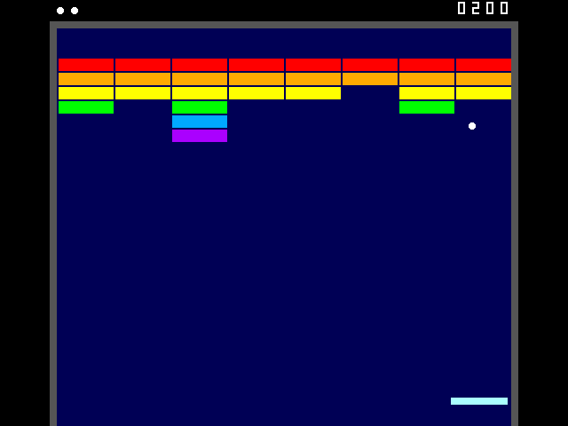
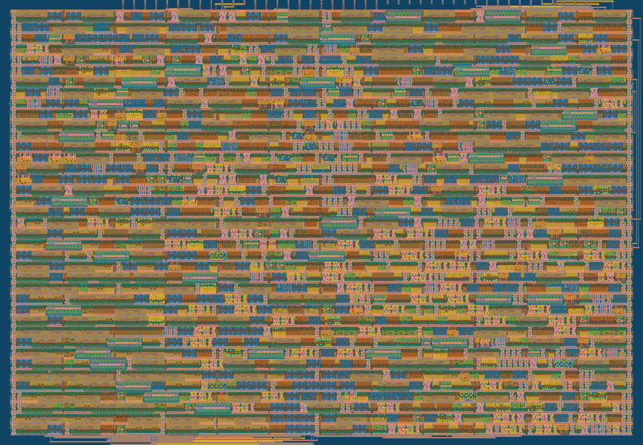

  

# Tiny Breakout

A complete VGA brick-breaker game in a single [Tiny Tapeout](https://tinytapeout.com) tile.



Tiny Breakout consists of some 12,500 transistors in 1,400 standard cells. There is no
processor or frame buffer; the game keeps its state in 165 flip-flops.

## The game

The rules are in [docs/info.md](docs/info.md). Play with an SNES controller
or plain buttons; SELECT hands the paddle over to autoplay, and with no controller connected
the game plays itself as a demo.

## How it fits in one tile

Every pixel of the 640×480, 60 Hz picture is worked out from the beam position as it is
drawn.

- The bricks are kept in a ring of flip-flops that turns with the beam, so the brick under the
  beam is always in the same flip-flop. This avoids a 48-way multiplexer and halves the wall's
  logic ([brick_wall.sv](src/brick_wall.sv)).
- Each wall after the first is generated as the ring fills. Its first row comes from a 5-bit
  LFSR, and each later row from the row before it, by an elementary cellular automaton
  (Wolfram's rules 150 and 182). This gives 21 brick patterns in under 1% of the tile.
- Collisions are read off the picture: a ball pixel drawn over a brick or the paddle is a hit.
  The ball's offset within its own 8×8 box at that pixel tells which edge of the brick it came
  through, so it bounces the right way.
- A faster ball doesn't take bigger steps: it moves more often, from every other frame up to
  twice a frame, during vertical blanking.

[](https://gds-explorer.tinytapeout.com/viewer?file=https://zvea.github.io/tiny-breakout/tinytapeout.oas&pdk=sky130A)

The layout can also be [explored in 3D](https://gds-explorer.tinytapeout.com/viewer?file=https://zvea.github.io/tiny-breakout/tinytapeout.oas&pdk=sky130A).

## Trying it without hardware

The interactive player runs the design's RTL in Verilator and streams the picture to a browser.
Every clock is simulated, so the game's speed depends on the processor. A fast one, such as an
Apple M4, can simulate the chip in real time. It needs Verilator 4 (see
[test/README.md](test/README.md#setting-up)):

```sh
cd sim/play
./build.sh
./obj_serve/Vtt_um_tiny_breakout    # then open http://localhost:8765/
```

`SOUND=1 ./build.sh` builds the player with the optional sound; turn it on with the button on the
page.

## Hardware

- A Tiny Tapeout chip with this design selected, clocked at 25.175 MHz.
- A [TinyVGA PMOD](https://github.com/mole99/tiny-vga) on the outputs, and a VGA monitor.
- A [Gamepad PMOD](https://github.com/psychogenic/gamepad-pmod) and an SNES-compatible
  controller on the inputs, or buttons on `ui[0]` to `ui[2]` and a switch on `ui[3]` for
  autoplay.
- For a chip built with sound (the define `TB_SOUND`, not in the standard build), an
  [Audio Pmod](https://github.com/MichaelBell/tt-audio-pmod) on `uio[7]`.

Pinout and controls are in [docs/info.md](docs/info.md).

## Licence

[Apache 2.0](LICENSE).
